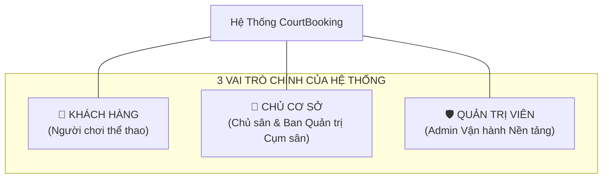
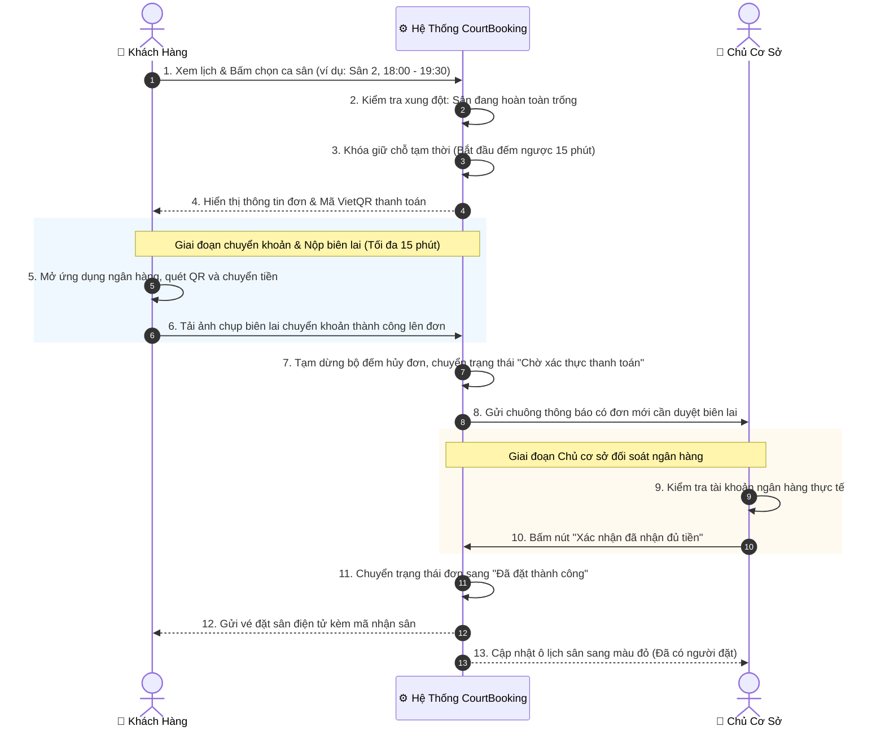
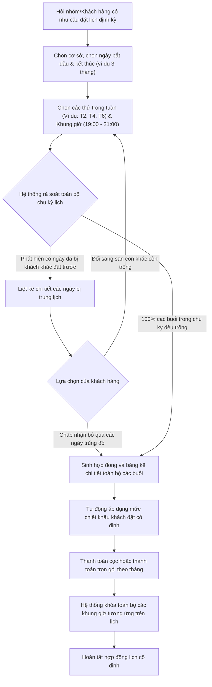
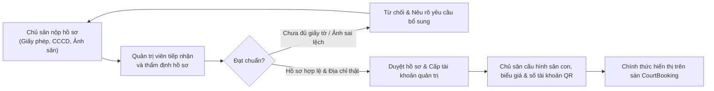
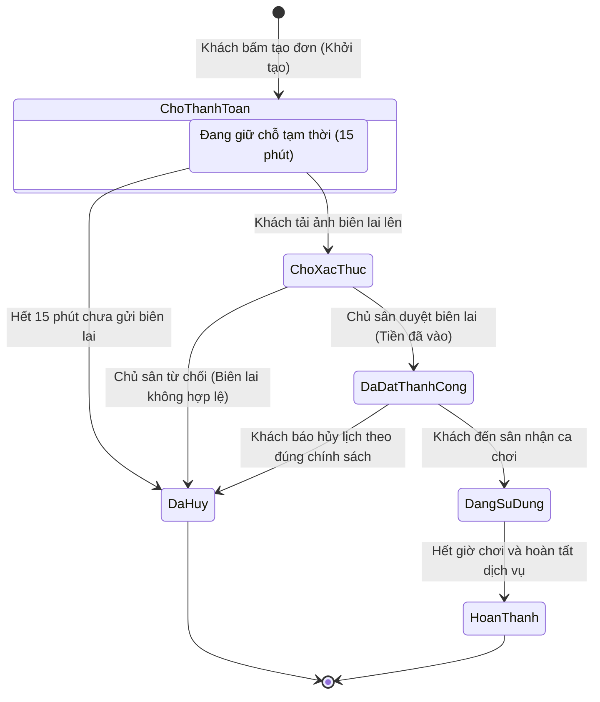

# TÀI LIỆU ĐẶC TẢ YÊU CẦU PHẦN MỀM (SRS)
## DỰ ÁN: NỀN TẢNG ĐẶT LỊCH VÀ QUẢN TRỊ CƠ SỞ THỂ THAO TOÀN DIỆN (COURTBOOKING)
**Tiêu chuẩn áp dụng:** IEEE 830-1998 (Recommended Practice for Software Requirements Specifications)  
**Phiên bản:** 1.0 (Business Edition - Khởi tạo)  
**Ngày phát hành:** 20/11/2026  
**Đơn vị thực hiện:** Đội ngũ Phân tích Nghiệp vụ (Business Analysis Team)

---

## MỤC LỤC
1. [GIỚI THIỆU (INTRODUCTION)](#1-giới-thiệu-introduction)
   - 1.1. Mục đích tài liệu
   - 1.2. Phạm vi sản phẩm
   - 1.3. Định nghĩa và Thuật ngữ nghiệp vụ
   - 1.4. Tài liệu tham khảo
   - 1.5. Tổng quan cấu trúc tài liệu
2. [MÔ TẢ TỔNG QUAN (OVERALL DESCRIPTION)](#2-mô-tả-tổng-quan-overall-description)
   - 2.1. Bối cảnh và Tầm nhìn sản phẩm
   - 2.2. Các phân hệ chức năng chính
   - 2.3. Nhóm người dùng và Đặc điểm vận hành
   - 2.4. Môi trường vận hành và Giả định kinh doanh
   - 2.5. Ràng buộc nghiệp vụ và Giới hạn triển khai
3. [YÊU CẦU CHỨC NĂNG CHI TIẾT (SPECIFIC FUNCTIONAL REQUIREMENTS)](#3-yêu-cầu-chức-năng-chi-tiết-specific-functional-requirements)
   - 3.1. Phân hệ Quản lý Tài khoản & Định danh
   - 3.2. Phân hệ Tìm kiếm & Khám phá Sân thể thao
   - 3.3. Phân hệ Đặt sân & Điều phối Khung giờ
   - 3.4. Phân hệ Bán lẻ & Dịch vụ tiện ích tại sân
   - 3.5. Phân hệ Thanh toán VietQR & Xác thực Biên lai
   - 3.6. Phân hệ Quản lý Cơ sở, Cụm sân & Bảng giá
   - 3.7. Phân hệ Giao lưu, Ghép đội & Kết nối Cộng đồng
   - 3.8. Phân hệ Sự kiện & Giải đấu thể thao
   - 3.9. Phân hệ Thống kê, Báo cáo & Doanh thu
   - 3.10. Phân hệ Quản trị Nền tảng & Kiểm duyệt Đối tác
4. [QUY TRÌNH NGHIỆP VỤ & QUY TẮC VẬN HÀNH (BUSINESS PROCESSES & RULES)](#4-quy-trình-nghiệp-vụ--quy-tắc-vận-hành-business-processes--rules)
   - 4.1. Quy trình Đặt sân trực tuyến và Xác thực Thanh toán
   - 4.2. Quy tắc Giữ chỗ tạm thời và Cơ chế Chống đặt trùng lịch
   - 4.3. Quy trình Đăng ký Lịch cố định định kỳ cho Hội nhóm
   - 4.4. Quy trình Lên đơn và Bán hàng trực tiếp tại quầy
   - 4.5. Quy trình Kiểm duyệt và Cấp phép Cơ sở thể thao
   - 4.6. Bảng vòng đời trạng thái Đơn đặt sân
5. [YÊU CẦU PHI CHỨC NĂNG (NON-FUNCTIONAL REQUIREMENTS)](#5-yêu-cầu-phi-chức-năng-non-functional-requirements)
   - 5.1. Hiệu năng và Thời gian phản hồi
   - 5.2. Tính sẵn sàng và Độ tin cậy
   - 5.3. An toàn thông tin và Quyền riêng tư
   - 5.4. Tính khả dụng và Trải nghiệm người dùng
   - 5.5. Khả năng bảo trì và Mở rộng
6. [PHỤ LỤC & MA TRẬN PHÂN QUYỀN (APPENDIX & ACCESS MATRIX)](#6-phụ-lục--ma-trận-phân-quyền-appendix--access-matrix)

---

# 1. GIỚI THIỆU (INTRODUCTION)

### 1.1. Mục đích tài liệu
Tài liệu Đặc tả Yêu cầu Phần mềm (SRS) này xác định toàn bộ các yêu cầu nghiệp vụ, yêu cầu chức năng, yêu cầu phi chức năng và quy trình vận hành cho nền tảng **CourtBooking**.  
Tài liệu đóng vai trò là căn cứ pháp lý và nghiệp vụ giữa các bên liên quan (Chủ đầu tư, Quản lý sản phẩm, Bộ phận Vận hành, Khách hàng thử nghiệm và Đội ngũ phát triển) để định hình phạm vi sản phẩm trước khi bước vào giai đoạn thiết kế giao diện và chế tác kỹ thuật.

### 1.2. Phạm vi sản phẩm
* **Tên giải pháp:** Hệ thống Nền tảng Đặt lịch và Quản trị Cơ sở Thể thao Toàn diện (**CourtBooking**).
* **Bản chất sản phẩm:** Nền tảng kết nối trực tuyến hai chiều (Two-sided Sports Marketplace & Facility Management Platform), phục vụ:
  1. Người chơi thể thao (tìm sân, giữ lịch, ghép kèo giao lưu, tham dự giải đấu).
  2. Chủ các cơ sở thể thao (tự động hóa quản lý ca sân, loại bỏ trùng lịch, quản lý đơn tại quầy, bán dịch vụ phụ trợ, tối ưu doanh thu).
  3. Đơn vị chủ quản nền tảng (kiểm soát chất lượng, thu phí dịch vụ nền tảng).
* **Phạm vi môn thể thao ban đầu:** Cầu lông, Pickleball, Quần vợt (Tennis), Bóng đá mini và các môn thể thao sử dụng mặt sân phân bổ theo khung giờ.

### 1.3. Định nghĩa và Thuật ngữ nghiệp vụ
Bảng thuật ngữ chuẩn hóa các khái niệm thực tế được sử dụng xuyên suốt tài liệu:

| Thuật ngữ nghiệp vụ | Giải thích ý nghĩa trong thực tế |
| :--- | :--- |
| **Cơ sở thể thao (Chi nhánh)** | Một địa điểm kinh doanh cụ thể, có địa chỉ thực tế, gồm nhiều cụm sân và khu vực phụ trợ (quầy thu ngân, bãi xe, căng tin). |
| **Sân (Court/Field)** | Một đơn vị mặt sân thể thao đơn lẻ tại cơ sở (ví dụ: Sân số 1, Sân số 2, Sân VIP). |
| **Khung giờ / Ca sân (Time Slot)** | Khoảng thời gian sử dụng sân được chia nhỏ theo tiêu chuẩn (ví dụ: các khoảng 30 phút hoặc 60 phút) trong ngày. |
| **Khung giờ cao điểm (Peak Hours)** | Khung thời gian có nhu cầu chơi thể thao lớn (ví dụ: 17:00 - 21:00 các ngày trong tuần và trọn ngày cuối tuần), thường có biểu giá cao hơn. |
| **Lịch đặt linh hoạt (Đặt lẻ)** | Khách hàng đặt một hoặc nhiều khung giờ tại một ngày cụ thể cho nhu cầu phát sinh đột xuất. |
| **Lịch cố định (Lịch định kỳ)** | Hợp đồng đặt sân dài hạn (theo tháng/quý) của các hội nhóm vào các ngày cố định trong tuần (ví dụ: Thứ 2-4-6 hàng tuần từ 18:00 - 20:00). |
| **Thời gian giữ chỗ tạm thời** | Khoảng thời gian hệ thống khóa tạm ca sân để khách hoàn tất nộp tiền chuyển khoản (mặc định 15 phút), ngăn người khác đặt chen ngang. |
| **Đơn tại quầy (Đơn trực tiếp)** | Đơn đặt sân hoặc bán nước/phụ kiện do nhân viên tại sân thực hiện cho khách đến chơi trực tiếp. |
| **Biên lai chuyển khoản** | Ảnh chụp màn hình giao dịch chuyển tiền ngân hàng thành công do khách hàng cung cấp làm bằng chứng đối soát. |
| **Giao lưu / Ghép đội** | Hoạt động một người chơi hoặc hội nhóm mở lời mời cộng đồng cùng vào chơi, chia sẻ tiền sân và kết nối thể thao. |

### 1.4. Tài liệu tham khảo
- Chuẩn đặc tả yêu cầu phần mềm quốc tế **IEEE Standard 830-1998**.
- Khảo sát thực tế quy trình vận hành tại các cụm sân Cầu lông và Pickleball đô thị năm 2026.
- Quy chuẩn định danh giao dịch thanh toán chuyển khoản nhanh qua mã phản hồi nhanh (VietQR tiêu chuẩn Napas).

### 1.5. Tổng quan cấu trúc tài liệu
Tài liệu được phân chia thành 6 chương chính, đi từ bức tranh tổng quát của hệ thống đến chi tiết từng chức năng cụ thể theo từng vai trò, kèm theo các sơ đồ quy trình nghiệp vụ thực tế giúp các bên dễ dàng hình dung và thẩm định.

---

# 2. MÔ TẢ TỔNG QUAN (OVERALL DESCRIPTION)

### 2.1. Bối cảnh và Tầm nhìn sản phẩm
Trong thực tế quản lý sân bãi thể thao truyền thống, các chủ sân thường ghi chép lịch qua sổ tay, tin nhắn Zalo hoặc bảng tính Excel rời rạc. Điều này dẫn đến các vấn đề nghiêm trọng:
1. **Trùng lịch sân (Double-booking):** Khách đặt online và khách gọi điện cùng chốt một sân trong một khung giờ cao điểm, gây mất uy tín và mâu thuẫn tại sân.
2. **Khó khăn trong thu tiền và đối soát:** Khách hứa hẹn nhưng không đến (bùng sân), hoặc khách gửi biên lai giả mạo/chuyển sai số tiền khiến nhân viên thu ngân thất thoát tiền bạc.
3. **Thất thoát hàng hóa phụ trợ:** Nước đóng chai, cầu lông, cho thuê vợt bị quản lý lỏng lẻo, không liên kết với ca sân của khách.
4. **Hạn chế trong việc lấp đầy sân giờ thấp điểm:** Các khung giờ ban ngày hoặc trưa thường bị bỏ trống do không có kênh quảng bá và kết nối người chơi linh hoạt.

**CourtBooking** ra đời như một hệ sinh thái đồng bộ: Vừa là kênh bán hàng trực tuyến cho người chơi tiếp cận nhanh chóng, vừa là công cụ quản trị thực tế tại quầy giúp chủ sân vận hành minh bạch, tự động hóa từ khâu giữ chỗ đến kiểm soát nguồn tiền.

### 2.2. Các phân hệ chức năng chính
Hệ thống được hợp thành từ 10 phân hệ nghiệp vụ cốt lõi:
1. **Phân hệ Tài khoản & Nhận diện người dùng:** Đăng ký, đăng nhập, bảo vệ thông tin cá nhân.
2. **Phân hệ Tra cứu & Khám phá:** Tìm kiếm sân theo khoảng cách địa lý, theo bộ môn, theo tầm giá và tiện ích đi kèm (máy lạnh, tắm nóng lạnh, bãi đỗ ô tô).
3. **Phân hệ Quản lý Lịch & Giữ chỗ:** Lưới thời gian trực quan, cơ chế giữ chỗ 15 phút, ngăn chặn tuyệt đối việc trùng giờ.
4. **Phân hệ Bán lẻ & Dịch vụ:** Bán nước giải khát, thuê đồ chơi thể thao gắn liền vào đơn sân hoặc bán lẻ trực tiếp.
5. **Phân hệ Thanh toán & Đối soát biên lai:** Tạo mã QR ngân hàng có sẵn số tiền và nội dung, tiếp nhận ảnh biên lai và quy trình duyệt hóa đơn.
6. **Phân hệ Quản trị Sân & Biểu giá:** Thiết lập số lượng sân con, cấu hình khung giờ mở cửa, khung giờ cao điểm, chính sách giá theo ngày thường và ngày lễ.
7. **Phân hệ Giao lưu & Ghép đội:** Nơi các nhóm thiếu người có thể đăng tin tìm bạn chơi, xét duyệt thành viên và chia sẻ chi phí sân.
8. **Phân hệ Sự kiện & Giải đấu:** Tổ chức các giải phong trào, bán vé tham gia giải, thông báo lịch thi đấu.
9. **Phân hệ Báo cáo Doanh thu & Vận hành:** Thống kê doanh số theo ngày/tuần/tháng, tỷ lệ khai thác công suất sân, lịch sử phục vụ.
10. **Phân hệ Quản trị Nền tảng:** Thẩm định hồ sơ mở sân của các chủ cơ sở, thu phí hoa hồng hoặc gói thành viên của chủ sân.

### 2.3. Nhóm người dùng và Đặc điểm vận hành
Hệ thống phân định chính xác **3 vai trò người dùng chính**:



#### 2.3.1. Khách hàng (Người chơi thể thao / Hội nhóm)
* **Đặc điểm:** Người có nhu cầu tìm sân chơi định kỳ hoặc đột xuất, các vận động viên phong trào, người tổ chức câu lạc bộ thể thao.
* **Mục tiêu sử dụng:**
  - Nhìn thấy ngay sân nào còn trống trong khung giờ mình rảnh rỗi.
  - Đặt sân nhanh chóng mà không cần gọi điện thoại qua lại nhiều lần.
  - Minh bạch giá cả, an tâm giữ chỗ khi đã chuyển khoản đặt cọc.
  - Tìm kiếm đồng đội hoặc đối thủ có trình độ tương đương để giao lưu nâng cao sức khỏe.

#### 2.3.2. Chủ cơ sở (Chủ sân & Ban Quản lý Cụm sân)
* **Đặc điểm:** Các cá nhân hoặc doanh nghiệp sở hữu từ 1 đến nhiều cụm sân thể thao; chịu trách nhiệm quản trị vận hành hàng ngày và dòng tiền thu vào.
* **Mục tiêu sử dụng:**
  - Nắm bắt tức thời tình trạng sân trong ngày trên màn hình tổng quan (Sân nào đang trống, sân nào đang có khách đá/đánh, sân nào sắp tới giờ nhận).
  - Lên đơn tại chỗ tức thì cho khách vãng lai bước vào quầy.
  - Khóa lịch cố định cả tháng/năm cho các khách ruột có hợp đồng dài hạn.
  - Xem biên lai chuyển khoản của khách online và bấm duyệt để hoàn tất đơn.
  - Quản lý kho nước uống, dụng cụ cho thuê và xem biểu đồ tiền thu được trong ngày.

#### 2.3.3. Quản trị viên (Admin Nền tảng)
* **Đặc điểm:** Nhân viên điều hành của đơn vị chủ quản nền tảng CourtBooking.
* **Mục tiêu sử dụng:**
  - Rà soát tính hợp pháp và xác thực giấy tờ của các cơ sở thể thao xin tham gia vào sàn.
  - Khóa tạm thời hoặc chấm dứt hợp tác với các cơ sở vi phạm quy chuẩn dịch vụ hoặc có nhiều khiếu nại từ người chơi.
  - Quản lý các gói thuê bao sử dụng phần mềm mà các chủ sân cần trả định kỳ để duy trì gian hàng.

### 2.4. Môi trường vận hành và Giả định kinh doanh
* **Môi trường thiết bị:**
  - *Khách hàng:* Sử dụng chủ yếu trên điện thoại di động thông minh (trình duyệt web di động hoặc ứng dụng di động) khi đang di chuyển, hoặc máy tính bảng/máy tính cá nhân.
  - *Chủ cơ sở:* Thường sử dụng trên máy tính bảng hoặc máy tính bàn đặt tại quầy thu ngân để dễ dàng theo dõi sơ đồ nhiều sân cùng lúc.
  - *Quản trị viên:* Sử dụng trên máy tính làm việc tiêu chuẩn.
* **Giả định kinh doanh:**
  - Mỗi cơ sở thể thao đều có tài khoản ngân hàng chính chủ để tạo mã QR tiếp nhận tiền thanh toán trực tiếp từ người chơi.
  - Khách hàng có khả năng thực hiện chuyển khoản trực tuyến qua ứng dụng ngân hàng và chụp màn hình biên lai giao dịch.
  - Mọi giao dịch đặt sân đều phải có ràng buộc thời gian cụ thể (theo ngày và giờ).

### 2.5. Ràng buộc nghiệp vụ và Giới hạn triển khai
1. **Nguyên tắc Chống đặt trùng tuyệt đối:** Một khung giờ trên một sân cụ thể tại một thời điểm chỉ cho phép tối đa một khách hàng giữ chỗ hoặc sở hữu. Hệ thống không cho phép tồn tại trạng thái chấp nhận hai đơn cùng đè lên một khoảng thời gian.
2. **Quy định về thời gian đặt chỗ trước:** Khách hàng không thể đặt sân cho các khung giờ đã trôi qua trong quá khứ.
3. **Quy định bảo lưu và hủy lịch:** Mọi yêu cầu hủy hoặc đổi lịch phải tuân theo chính sách riêng mà chủ cơ sở đã ban hành công khai (ví dụ: chỉ được báo hủy trước tối thiểu 12 tiếng).
4. **Thanh toán chuyển khoản:** Hệ thống không can thiệp trực tiếp trừ tiền trong tài khoản ngân hàng của khách mà dựa trên quy trình tạo mã QR tiêu chuẩn và duyệt biên lai thực tế bởi chủ cơ sở.

---

# 3. YÊU CẦU CHỨC NĂNG CHI TIẾT (SPECIFIC FUNCTIONAL REQUIREMENTS)

Mỗi yêu cầu chức năng được đánh mã nhận diện theo định dạng: **FR-[Phân hệ]-[Số thứ tự]**.

```
Mã phân hệ:
- TK: Tài khoản & Định danh
- TC: Tra cứu & Khám phá
- DS: Đặt sân & Lịch
- BL: Bán lẻ & Tiện ích
- TT: Thanh toán & Đối soát
- CS: Quản trị Cơ sở & Bảng giá
- GL: Giao lưu & Ghép đội
- SK: Sự kiện & Giải đấu
- BC: Báo cáo & Doanh thu
- QT: Quản trị Nền tảng
```

---

### 3.1. Phân hệ Quản lý Tài khoản & Định danh (FR-TK)

#### FR-TK-01: Đăng ký tài khoản người dùng
* **Tác nhân:** Khách hàng, Chủ cơ sở mới.
* **Mục đích:** Tạo lập tài khoản định danh trên nền tảng.
* **Quy tắc nghiệp vụ:**
  - Người dùng cung cấp: Họ và tên, Số điện thoại (dùng làm tên đăng nhập duy nhất), Địa chỉ thư điện tử và Mật khẩu bảo vệ.
  - Số điện thoại phải là số hợp lệ tại Việt Nam (10 chữ số). Mỗi số điện thoại chỉ gắn với một tài khoản duy nhất.
  - Hệ thống yêu cầu xác nhận mật khẩu có độ dài tối thiểu để đảm bảo tính an toàn.

#### FR-TK-02: Đăng nhập và Khôi phục quyền truy cập
* **Tác nhân:** Tất cả người dùng.
* **Mục đích:** Xác thực danh tính để truy cập vào các tính năng tương ứng theo vai trò.
* **Quy tắc nghiệp vụ:**
  - Hỗ trợ đăng nhập bằng Số điện thoại/Email cùng Mật khẩu.
  - Cung cấp quy trình "Quên mật khẩu" thông qua việc gửi mã xác thực về Email hoặc Số điện thoại đã đăng ký.
  - Người dùng đăng nhập thành công sẽ được tự động chuyển hướng về đúng giao diện quyền hạn của mình (Khách hàng về trang chủ, Chủ cơ sở về trang điều phối sân, Quản trị viên về trang tổng tài).

#### FR-TK-03: Cập nhật hồ sơ cá nhân
* **Tác nhân:** Khách hàng, Chủ cơ sở.
* **Mục đích:** Thay đổi ảnh đại diện, số điện thoại liên hệ, môn thể thao yêu thích, trình độ thi đấu (đối với khách hàng) hoặc thông tin giới thiệu cơ sở (đối với chủ cơ sở).

---

### 3.2. Phân hệ Tra cứu & Khám phá Sân thể thao (FR-TC)

#### FR-TC-01: Tìm kiếm cơ sở thể thao đa tiêu chí
* **Tác nhân:** Khách hàng.
* **Mục đích:** Nhanh chóng tìm thấy cụm sân ưng ý gần khu vực sinh sống.
* **Quy tắc nghiệp vụ:**
  - Hỗ trợ bộ lọc linh hoạt:
    + Theo Tỉnh/Thành phố, Quận/Huyện hoặc tìm kiếm xung quanh vị trí hiện tại.
    + Theo Môn thể thao (Cầu lông, Pickleball, Tennis...).
    + Theo Khoảng giá theo giờ (ví dụ: từ 100.000đ - 200.000đ/giờ).
    + Theo Tiện ích đi kèm: Chỗ đỗ xe ô tô, Có phòng tắm, Có điều hòa, Cho thuê vợt, Bán nước, Wifi miễn phí.
  - Danh sách trả về hiển thị trực quan: Tên cơ sở, Địa chỉ, Đánh giá trung bình từ cộng đồng, Mức giá dao động và Ảnh đại diện thực tế.

#### FR-TC-02: Xem chi tiết cơ sở thể thao và Danh sách sân con
* **Tác nhân:** Khách hàng.
* **Mục đích:** Nắm rõ quy mô, hình ảnh thực tế và các quy định riêng của từng cơ sở trước khi quyết định đặt.
* **Quy tắc nghiệp vụ:**
  - Hiển thị đầy đủ album ảnh chất lượng mặt sân, ánh sáng, khuôn viên.
  - Liệt kê các sân con hiện có (ví dụ: Sân 1 - Thảm tiêu chuẩn, Sân 2 - Thảm thi đấu quốc tế).
  - Hiển thị Bảng giá công khai theo từng khung giờ trong ngày (giờ thường và giờ cao điểm).
  - Cung cấp chính sách hoàn/hủy lịch và nội quy riêng của cơ sở.

#### FR-TC-03: Xem đánh giá và bình luận cộng đồng
* **Tác nhân:** Khách hàng.
* **Mục đích:** Tham khảo ý kiến thực tế từ những người chơi đã từng trải nghiệm tại sân.
* **Quy tắc nghiệp vụ:**
  - Chỉ những khách hàng đã hoàn thành đơn đặt sân thực tế tại cơ sở mới được quyền chấm điểm (từ 1 đến 5 sao) và để lại nhận xét bằng văn bản hoặc hình ảnh.
  - Chủ cơ sở có quyền viết phản hồi chính thức dưới từng bình luận của khách hàng.

---

### 3.3. Phân hệ Đặt sân & Điều phối Khung giờ (FR-DS)

#### FR-DS-01: Xem sơ đồ thời gian thực (Lưới lịch sân)
* **Tác nhân:** Khách hàng, Chủ cơ sở.
* **Mục đích:** Quan sát trực quan tình trạng của toàn bộ các sân theo trục thời gian trong ngày.
* **Quy tắc nghiệp vụ:**
  - Màn hình hiển thị theo dạng ma trận: Trục ngang là các sân (Sân 1, Sân 2...), trục dọc là các mốc thời gian chia theo từng block 30 phút.
  - Phân định rõ ràng bằng màu sắc trực quan:
    + **Ô màu Trắng/Xanh nhạt:** Khung giờ còn trống, sẵn sàng nhận đặt.
    + **Ô màu Vàng:** Đang có khách giữ chỗ tạm thời (đang trong 15 phút chuyển khoản).
    + **Ô màu Đỏ/Xám đậm:** Đã có khách đặt thành công hoặc đã khóa lịch cố định.
    + **Ô có gạch chéo:** Giờ sân bảo trì, không phục vụ.

#### FR-DS-02: Đặt lịch linh hoạt theo giờ (Đặt lẻ)
* **Tác nhân:** Khách hàng.
* **Mục đích:** Chọn một hoặc nhiều ca sân trong ngày cho buổi chơi thể thao cá nhân/nhóm.
* **Quy tắc nghiệp vụ:**
  - Khách hàng bấm chọn một hoặc nhiều khung giờ liên tiếp trên cùng một sân hoặc khác sân.
  - Hệ thống tự động tính toán tổng số tiền dựa theo biểu giá của từng khung giờ tương ứng.
  - Khách hàng có thể chọn thêm các dịch vụ đi kèm (nước uống, phụ kiện) trước khi bấm chuyển sang bước thanh toán.
  - Khi khách hàng xác nhận gửi đơn, khung giờ đó ngay lập tức chuyển sang trạng thái **"Đang giữ chỗ tạm thời"** và đếm ngược 15 phút.

#### FR-DS-03: Đăng ký lịch cố định định kỳ (Dành cho Hội nhóm)
* **Tác nhân:** Khách hàng, Chủ cơ sở.
* **Mục đích:** Giữ sân lâu dài theo chu kỳ tuần/tháng cho các hội cố định.
* **Quy tắc nghiệp vụ:**
  - Người đặt chọn: Ngày bắt đầu, Ngày kết thúc chu kỳ (ví dụ: từ 01/12 đến 28/02 năm sau), các Thứ trong tuần (ví dụ: Thứ 2, Thứ 4, Thứ 6) và Khung giờ cố định (ví dụ: 19:00 - 21:00).
  - Hệ thống tự động kiểm tra toàn bộ các ngày phát sinh trong chu kỳ:
    + Nếu tất cả các ngày đều trống: Cho phép tiến hành tạo hợp đồng cố định.
    + Nếu có một hoặc vài ngày bị trùng lịch với đơn có trước: Hệ thống liệt kê chi tiết các ngày bị trùng để người đặt đổi sang sân khác hoặc loại trừ ngày đó.
  - Áp dụng chính sách giá ưu đãi dành riêng cho khách đặt cố định (do chủ sân thiết lập).

#### FR-DS-04: Lên đơn trực tiếp tại quầy (Dành cho khách vãng lai)
* **Tác nhân:** Chủ cơ sở.
* **Mục đích:** Xếp sân nhanh cho khách đến chơi trực tiếp mà không qua ứng dụng.
* **Quy tắc nghiệp vụ:**
  - Chủ sân bấm trực tiếp vào khung giờ còn trống trên màn hình lịch.
  - Nhập tên khách hàng và số điện thoại liên hệ (hoặc chọn khách quen có sẵn trong danh bạ sân).
  - Chọn hình thức thu tiền: Thu tiền mặt ngay hoặc Hướng dẫn quét mã QR tại quầy.
  - Sau khi xác nhận, ca sân lập tức chuyển sang trạng thái **"Đã đặt thành công"** mà không cần qua bước giữ chỗ tạm thời.

---

### 3.4. Phân hệ Bán lẻ & Dịch vụ tiện ích tại sân (FR-BL)

#### FR-BL-01: Quản lý danh mục hàng hóa & dịch vụ tiện ích
* **Tác nhân:** Chủ cơ sở.
* **Mục đích:** Thiết lập các sản phẩm nước uống, phụ kiện và dịch vụ cho thuê phục vụ người chơi.
* **Quy tắc nghiệp vụ:**
  - Phân nhóm rõ ràng:
    + **Nhóm nước giải khát & dinh dưỡng:** Nước suối, nước điện giải, nước ngọt, chuối, thanh năng lượng...
    + **Nhóm phụ kiện bán đứt:** Quả cầu lông, bóng pickleball, băng quấn cán vợt, tất thể thao...
    + **Nhóm dụng cụ cho thuê:** Thuê vợt cầu lông/pickleball theo buổi, thuê giày thể thao, khăn lau...
  - Thiết lập giá bán, đơn vị tính (chai, lon, quả, cây, giờ) và số lượng tồn kho thực tế.

#### FR-BL-02: Bán kèm dịch vụ trong đơn đặt sân
* **Tác nhân:** Khách hàng (khi đặt online) hoặc Chủ cơ sở (khi tiếp khách tại sân).
* **Mục đích:** Chuẩn bị sẵn nước uống và dụng cụ ngay khi khách bước chân vào sân.
* **Quy tắc nghiệp vụ:**
  - Tiền hàng hóa/dịch vụ được tự động cộng dồn vào hóa đơn tổng của ca sân tương ứng.
  - Khi đơn sân được duyệt, hệ thống tự động trừ số lượng hàng hóa tương ứng trong kho của cơ sở.

#### FR-BL-03: Đơn bán lẻ độc lập tại quầy
* **Tác nhân:** Chủ cơ sở.
* **Mục đích:** Bán nước hoặc phụ kiện cho người đi cùng hoặc khách không có lịch đặt sân.
* **Quy tắc nghiệp vụ:**
  - Lên đơn tính tiền độc lập, không gắn với bất kỳ ca sân nào.
  - In hóa đơn hoặc hiển thị tổng tiền cần thanh toán cho khách.

---

### 3.5. Phân hệ Thanh toán VietQR & Xác thực Biên lai (FR-TT)

#### FR-TT-01: Sinh mã chuyển khoản ngân hàng thông minh (VietQR)
* **Tác nhân:** Hệ thống.
* **Mục đích:** Giúp khách hàng thanh toán chính xác tuyệt đối mà không cần nhập tay số tài khoản hay số tiền.
* **Quy tắc nghiệp vụ:**
  - Ngay khi đơn hàng được tạo, hệ thống hiển thị mã QR chuyển khoản trực tiếp vào tài khoản ngân hàng của cơ sở đó.
  - Nội dung chuyển khoản được mã hóa chuẩn hóa gồm: Mã đơn hàng và Số điện thoại khách hàng.
  - Số tiền chuyển khoản hiển thị đúng bằng giá trị cần thanh toán (tiền đặt cọc hoặc 100% tiền sân).

#### FR-TT-02: Tải lên hình ảnh biên lai giao dịch
* **Tác nhân:** Khách hàng.
* **Mục đích:** Cung cấp minh chứng đã chuyển khoản thành công để giữ chỗ chính thức.
* **Quy tắc nghiệp vụ:**
  - Khách hàng chụp màn hình giao dịch thành công trên ứng dụng ngân hàng và tải ảnh lên trực tiếp tại trang chi tiết đơn.
  - Ảnh biên lai phải được tải lên trong vòng **15 phút** kể từ thời điểm tạo đơn.
  - Sau khi khách bấm "Xác nhận đã chuyển khoản" kèm ảnh, đơn chuyển sang trạng thái **"Chờ xác thực thanh toán"**. Đồng hồ đếm ngược 15 phút sẽ tạm dừng hủy đơn.

#### FR-TT-03: Thẩm định và Xác nhận biên lai chuyển khoản
* **Tác nhân:** Chủ cơ sở.
* **Mục đích:** Đối soát biến động số dư tài khoản ngân hàng thực tế với ảnh biên lai khách gửi.
* **Quy tắc nghiệp vụ:**
  - Chủ cơ sở nhận được thông báo tức thời có đơn mới cần xác nhận.
  - Mở chi tiết đơn để phóng to xem ảnh biên lai (kiểm tra rõ: Số tiền, Thời gian chuyển, Tên người nhận, Nội dung chuyển).
  - Có 2 lựa chọn xử lý:
    + **Đồng ý xác nhận:** Đơn chuyển sang trạng thái **"Đã đặt thành công"**. Hệ thống gửi thông báo xác nhận kèm vé điện tử cho khách hàng.
    + **Từ chối / Yêu cầu gửi lại:** Nêu rõ lý do (ví dụ: "Tiền chưa vào tài khoản", "Chuyển thiếu 50.000đ", "Ảnh mờ không thấy mã giao dịch"). Khách hàng nhận được thông báo để bổ sung hoặc liên hệ trực tiếp.

---

### 3.6. Phân hệ Quản lý Cơ sở, Cụm sân & Bảng giá (FR-CS)

#### FR-CS-01: Khởi tạo và Quản lý thông tin cơ sở
* **Tác nhân:** Chủ cơ sở.
* **Mục đích:** Cập nhật hồ sơ pháp lý, vị trí và thông tin quảng bá của cơ sở thể thao.
* **Quy tắc nghiệp vụ:**
  - Cập nhật Tên cơ sở, Giờ mở cửa - Giờ đóng cửa (ví dụ: 06:00 - 23:00 hàng ngày).
  - Định vị tọa độ chính xác trên bản đồ để khách hàng dễ dàng tìm đường.
  - Đăng tải thông tin tài khoản ngân hàng thụ hưởng (Ngân hàng, Số tài khoản, Tên chủ thẻ) để hệ thống tích hợp sinh mã VietQR.

#### FR-CS-02: Quản lý danh sách sân con
* **Tác nhân:** Chủ cơ sở.
* **Mục đích:** Phân loại và cấu hình từng mặt sân trong cụm.
* **Quy tắc nghiệp vụ:**
  - Thêm, sửa, đóng tạm thời từng sân con.
  - Phân loại mặt sân (Sân thảm PVC cao cấp, Sân gỗ, Sân ngoài trời, Sân trong nhà có mái che).
  - Đánh số thứ tự sân trực quan để nhân viên và khách dễ nhận biết khi đến chơi.

#### FR-CS-03: Cấu hình biểu giá nâng cao theo khung giờ
* **Tác nhân:** Chủ cơ sở.
* **Mục đích:** Tối ưu hóa doanh thu theo quy luật cung cầu thị trường.
* **Quy tắc nghiệp vụ:**
  - Cho phép chia một ngày thành nhiều khung giờ có mức giá khác nhau:
    + *Khung giờ bình thường (Sáng/Trưa):* Ví dụ 80.000đ - 120.000đ/giờ.
    + *Khung giờ cao điểm (Chiều tối từ 17:00 - 21:00):* Ví dụ 180.000đ - 250.000đ/giờ.
  - Thiết lập giá riêng biệt cho:
    + Ngày trong tuần (Thứ 2 đến Thứ 6).
    + Ngày cuối tuần (Thứ 7 và Chủ nhật).
    + Ngày Lễ / Tết đặc biệt.
  - Thiết lập mức chiết khấu phần trăm (%) cho khách đặt lịch cố định theo tháng.

---

### 3.7. Phân hệ Giao lưu, Ghép đội & Kết nối Cộng đồng (FR-GL)

#### FR-GL-01: Tạo bài đăng tìm bạn chơi thể thao (Kèo giao lưu)
* **Tác nhân:** Khách hàng.
* **Mục đích:** Chủ động tìm kiếm người chơi cùng khi nhóm mình bị thiếu quân số hoặc muốn mở rộng vòng tròn bạn bè.
* **Quy tắc nghiệp vụ:**
  - Người tạo bài (Chủ kèo) chọn một đơn sân mình đã đặt thành công hoặc nhập thông tin ca sân dự kiến.
  - Thiết lập các tiêu chí tuyển người:
    + Bộ môn thi đấu (Cầu lông đôi nam, Đôi nam nữ, Pickleball đơn...).
    + Trình độ mong muốn (Mới tập chơi, Trung bình, Khá, Bán chuyên).
    + Số lượng người cần tuyển thêm (ví dụ: Cần thêm 2 người).
    + Hình thức chia tiền: Miễn phí, Chia đều tiền sân tại chỗ, hoặc Trả cố định một mức giá (ví dụ: 50.000đ/người).

#### FR-GL-02: Tham gia và Phê duyệt thành viên vào kèo
* **Tác nhân:** Khách hàng.
* **Mục đích:** Ứng tuyển vào các trận đấu phù hợp với thời gian và trình độ của mình.
* **Quy tắc nghiệp vụ:**
  - Người chơi duyệt danh sách các kèo giao lưu đang mở xung quanh khu vực.
  - Bấm "Xin tham gia" kèm lời nhắn tự giới thiệu trình độ.
  - Chủ kèo nhận được thông báo và xem hồ sơ người xin tham gia:
    + Chủ kèo bấm **"Đồng ý"**: Người chơi chính thức vào danh sách đội, hệ thống cập nhật số chỗ còn trống.
    + Khi đủ số lượng người đăng ký: Bài đăng tự động chuyển sang trạng thái **"Đã chốt danh sách"**.

---

### 3.8. Phân hệ Sự kiện & Giải đấu thể thao (FR-SK)

#### FR-SK-01: Tạo lập và Công bố giải đấu thể thao
* **Tác nhân:** Chủ cơ sở.
* **Mục đích:** Tổ chức các giải đấu phong trào nhằm tăng độ nhận diện thương hiệu và tăng doanh thu bán hàng phụ trợ.
* **Quy tắc nghiệp vụ:**
  - Nhập thông tin giải: Tên giải đấu, Điều lệ thi đấu, Cơ cấu giải thưởng, Thời hạn đăng ký và Ngày thi đấu chính thức.
  - Quy định số lượng vận động viên/đội tham gia tối đa (ví dụ: Tối đa 16 cặp vận động viên).
  - Quy định lệ phí tham gia thi đấu cho mỗi vận động viên/đội.

#### FR-SK-02: Đăng ký vé tham dự và Tham gia thi đấu
* **Tác nhân:** Khách hàng.
* **Mục đích:** Ghi danh tham gia thi đấu giao lưu hoặc mua vé cổ vũ.
* **Quy tắc nghiệp vụ:**
  - Điền danh sách vận động viên chính thức (Họ tên, Năm sinh, Trình độ).
  - Thực hiện thanh toán lệ phí thi đấu qua mã VietQR tương tự quy trình đặt sân.
  - Ban tổ chức duyệt lệ phí và cấp mã số vận động viên chính thức.

---

### 3.9. Phân hệ Thống kê, Báo cáo & Doanh thu (FR-BC)

#### FR-BC-01: Báo cáo doanh thu tài chính tổng hợp
* **Tác nhân:** Chủ cơ sở.
* **Mục đích:** Theo dõi sức khỏe tài chính và dòng tiền vào của cơ sở.
* **Quy tắc nghiệp vụ:**
  - Xem tổng doanh thu theo ngày, theo tuần, theo tháng hoặc theo khoảng thời gian tùy chọn.
  - Phân tách nguồn thu rõ ràng thành các mục:
    + Doanh thu từ tiền cho thuê sân (Đặt lẻ online + Đặt cố định + Khách tại quầy).
    + Doanh thu từ bán nước và đồ ăn nhẹ.
    + Doanh thu từ cho thuê dụng cụ và bán phụ kiện.
  - Phân tách theo phương thức nhận tiền: Tiền mặt tại quầy hay Chuyển khoản ngân hàng.

#### FR-BC-02: Thống kê hiệu suất khai thác công suất sân
* **Tác nhân:** Chủ cơ sở.
* **Mục đích:** Nhận biết các khung giờ ế ẩm để có chương trình khuyến mãi kích cầu.
* **Quy tắc nghiệp vụ:**
  - Biểu đồ nhiệt hiển thị tỷ lệ lấp đầy sân (Occupancy Rate) trong 24 giờ.
  - Thống kê các sân con có tần suất hoạt động cao nhất và thấp nhất.
  - Đưa ra con số trung bình khách hủy sân hoặc bỏ giờ để chủ sân điều chỉnh chính sách cọc.

---

### 3.10. Phân hệ Quản trị Nền tảng & Kiểm duyệt Đối tác (FR-QT)

#### FR-QT-01: Thẩm định hồ sơ gia nhập của Cơ sở thể thao mới
* **Tác nhân:** Quản trị viên.
* **Mục đích:** Đảm bảo chỉ các cơ sở có thật, uy tín và minh bạch mới được xuất hiện trên sàn CourtBooking.
* **Quy tắc nghiệp vụ:**
  - Rà soát hồ sơ chủ sân gửi lên: Giấy phép đăng ký kinh doanh/Hộ kinh doanh cá thể, Hình ảnh thực tế cụm sân, Căn cước công dân của người đại diện.
  - Quyết định Phê duyệt (Cấp quyền mở bán trên sàn) hoặc Từ chối (Nêu rõ tài liệu cần bổ sung).

#### FR-QT-02: Quản lý gói thuê bao dịch vụ nền tảng (Dành cho Chủ sân)
* **Tác nhân:** Quản trị viên.
* **Mục đích:** Thu phí vận hành hệ thống phần mềm đối với các chủ sân.
* **Quy tắc nghiệp vụ:**
  - Thiết lập các gói dịch vụ linh hoạt (Ví dụ: Gói Cơ bản cho cụm dưới 4 sân, Gói Nâng cao cho cụm từ 5-10 sân, Gói Không giới hạn cho chuỗi nhiều chi nhánh).
  - Tự động cảnh báo và thông báo khi chủ cơ sở sắp hết hạn gói thuê bao để gia hạn.

---

# 4. QUY TRÌNH NGHIỆP VỤ & QUY TẮC VẬN HÀNH (BUSINESS PROCESSES & RULES)

### 4.1. Quy trình Đặt sân trực tuyến và Xác thực Thanh toán

Quy trình chuẩn diễn ra giữa **Khách hàng**, **Hệ thống** và **Chủ cơ sở**:



---

### 4.2. Quy tắc Giữ chỗ tạm thời và Cơ chế Chống đặt trùng lịch

Để giải quyết triệt để tình trạng hai người cùng tranh nhau một khung giờ đẹp, hệ thống vận hành theo quy tắc nghiêm ngặt:

1. **Khóa ca sân tức thì khi khách bấm Đặt:** 
   - Ngay khoảnh khắc một khách hàng bấm vào nút xác nhận tạo đơn cho ca sân (ví dụ: 18:00 - 19:00 ngày 25/11), hệ thống ngay lập tức kích hoạt trạng thái **"Đang giữ chỗ tạm thời"** trên sơ đồ công khai.
   - Bất kỳ khách hàng nào khác truy cập vào màn hình lúc này sẽ nhìn thấy ô thời gian đó đổi sang màu vàng và nút đặt bị khóa lại, không thể bấm chọn.
2. **Quy định thời hạn nộp biên lai (15 phút):**
   - Khách hàng có đúng 15 phút để hoàn tất việc chuyển khoản và gửi ảnh biên lai lên hệ thống.
   - Đồng hồ đếm ngược được hiển thị to, rõ ràng trên màn hình của khách.
3. **Quy tắc giải phóng ca sân tự động (Hết hạn):**
   - Nếu hết 15 phút mà khách hàng **chưa tải ảnh biên lai**: Hệ thống tự động chuyển đơn sang trạng thái **"Đã hủy do quá hạn thanh toán"**, đồng thời mở khóa ca sân trở lại trạng thái trống (màu xanh) để người khác có thể đặt.
   - Nếu khách hàng đã tải ảnh thành công trước phút thứ 15: Ca sân tiếp tục được giữ chỗ an toàn để chờ chủ sân kiểm tra, tuyệt đối không bị giải phóng tự động.

---

### 4.3. Quy trình Đăng ký Lịch cố định định kỳ cho Hội nhóm

Quy trình xử lý các hợp đồng chơi dài hạn:



---

### 4.4. Quy trình Lên đơn và Bán hàng trực tiếp tại quầy

Dành riêng cho nhân viên/chủ sân phục vụ khách vãng lai trực tiếp tại cơ sở:

1. **Bước 1: Tiếp nhận yêu cầu tại quầy:** Khách hàng đến sân hỏi thuê sân ngay hoặc mua nước, thuê vợt.
2. **Bước 2: Thao tác trên Lưới lịch sân:** Chủ sân mở giao diện điều phối, chạm vào ca sân còn trống đang diễn ra hoặc chuẩn bị bắt đầu.
3. **Bước 3: Chọn dịch vụ kèm theo:** Nhập số lượng nước giải khát (ví dụ: 4 chai nước khoáng), vợt thuê lấy từ kho.
4. **Bước 4: Xác nhận thanh toán tại chỗ:**
   - *Nếu khách trả tiền mặt:* Thu tiền, bấm "Đã thu tiền mặt", hệ thống xuất phiếu giao sân.
   - *Nếu khách chuyển khoản:* Bấm "Tạo mã QR", màn hình tại quầy hiển thị mã QR động để khách quét trực tiếp bằng điện thoại. Khách chuyển xong, nhân viên kiểm tra thông báo tài khoản và bấm "Hoàn tất".

---

### 4.5. Quy trình Kiểm duyệt và Cấp phép Cơ sở thể thao

Đảm bảo an toàn thông tin và uy tín cho toàn bộ hệ sinh thái:



---

### 4.6. Bảng vòng đời trạng thái Đơn đặt sân (Business Status Flow)

Mọi đơn đặt trên hệ thống chỉ vận hành xoay quanh các trạng thái bằng tiếng Việt rõ ràng sau:



#### Giải thích chi tiết các trạng thái:
* **Chờ thanh toán (Đang giữ chỗ tạm thời):** Khung giờ được khóa độc quyền cho người đặt trong tối đa 15 phút.
* **Chờ xác thực thanh toán:** Khách đã chuyển khoản và tải ảnh biên lai thành công. Bộ đếm thời gian tạm dừng, chờ người quản lý kiểm tra tài khoản.
* **Đã đặt thành công:** Tiền đã được xác nhận vào tài khoản. Vé điện tử được cấp, sân đổi sang màu đỏ khóa kín.
* **Đang sử dụng:** Khách đã có mặt tại cơ sở và đang tiến hành thi đấu/chơi thể thao trong khung giờ.
* **Hoàn thành:** Buổi chơi kết thúc tốt đẹp, hai bên không còn khiếu nại. Khách hàng có thể viết đánh giá.
* **Đã hủy:** Đơn bị chấm dứt do hết hạn 15 phút, khách tự hủy hợp lệ, hoặc chủ sân từ chối do biên lai giả mạo/chuyển sai số tiền.

---

# 5. YÊU CẦU PHI CHỨC NĂNG (NON-FUNCTIONAL REQUIREMENTS)

### 5.1. Hiệu năng và Thời gian phản hồi
* **Thời gian khóa giữ chỗ tức thì:** Ngay khi khách bấm xác nhận đặt chỗ, thao tác khóa ca sân trên hệ thống phải diễn ra trong vòng dưới **1 giây**, đảm bảo khách hàng khác cùng xem màn hình không thể bấm chọn trùng.
* **Thời gian tải sơ đồ lịch sân:** Màn hình lưới lịch sân với đầy đủ dữ liệu trong ngày phải hiển thị hoàn chỉnh cho người dùng trong vòng dưới **2 giây** ở điều kiện kết nối internet di động 4G thông thường.
* **Khả năng chịu tải giờ cao điểm:** Hệ thống đáp ứng mượt mà khi có hàng nghìn lượt người cùng truy cập tìm kiếm và tra cứu sân cùng lúc vào các khung giờ vàng (11:00 - 13:00 và 17:00 - 20:00).

### 5.2. Tính sẵn sàng và Độ tin cậy
* **Độ chính xác lịch trình 100%:** Cam kết loại bỏ 100% hiện tượng đặt trùng sân (Double-booking). Không có bất kỳ trường hợp nào hai khách hàng khác nhau được cấp cùng một khung giờ trên cùng một mặt sân.
* **Độ sẵn sàng vận hành (High Availability):** Hệ thống duy trì hoạt động liên tục 24/7 với tỷ lệ sẵn sàng đạt tối thiểu **99.5%**, ngoại trừ các khung giờ thông báo bảo trì nâng cấp định kỳ vào ban đêm (02:00 - 04:00 sáng).
* **Bảo toàn dữ liệu hóa đơn:** Mọi thông tin đơn hàng, ảnh biên lai giao dịch và lịch sử thanh toán được lưu trữ an toàn, toàn vẹn trong tối thiểu 3 năm phục vụ công tác thanh kiểm tra sổ sách kế toán của chủ sân.

### 5.3. An toàn thông tin và Quyền riêng tư
* **Bảo vệ dữ liệu khách hàng:** Số điện thoại, email và lịch sử đặt sân của người chơi được bảo mật nghiêm ngặt; chủ sân chỉ được xem số điện thoại của khách hàng có đơn đặt trực tiếp tại cơ sở mình để tiện liên lạc đón tiếp.
* **Bảo mật minh chứng giao dịch:** Ảnh biên lai chuyển khoản chỉ có người đặt đơn và chủ cơ sở tương ứng mới có quyền xem, tránh lộ thông tin số tài khoản cá nhân ra bên ngoài.
* **Minh bạch tài chính:** Bất kỳ thao tác hủy đơn, hoàn tiền hoặc từ chối đơn đều phải lưu kèm lý do văn bản rõ ràng và định danh người thực hiện thao tác.

### 5.4. Tính khả dụng và Trải nghiệm người dùng
* **Tính trực quan (Không cần đào tạo phức tạp):** Giao diện lưới lịch sân thiết kế mô phỏng bàn làm việc thực tế, nhân viên thu ngân lớn tuổi hoặc chưa thành thạo máy tính đều có thể nắm bắt cách lên đơn và xếp sân trong vòng 15 phút làm quen.
* **Thân thiện trên thiết bị di động (Mobile-friendly):** Giao diện của Khách hàng được tối ưu hoàn hảo cho thao tác vuốt, chạm bằng một tay trên điện thoại di động; nút bấm to, rõ ràng, dễ nhìn ngoài trời nắng.
* **Đa ngôn ngữ & Tiền tệ chuẩn:** Toàn bộ giao diện sử dụng ngôn ngữ Tiếng Việt chuẩn mực, đơn vị tiền tệ cố định là Việt Nam Đồng (VNĐ) có dấu phân cách hàng nghìn rõ ràng (ví dụ: 150.000 VNĐ).

### 5.5. Khả năng bảo trì và Mở rộng
* Hệ thống được thiết kế theo dạng module hóa độc lập, cho phép tương lai tích hợp thêm các cổng thanh toán tự động (VNPay, MoMo, ZaloPay), hệ thống bật/tắt đèn sân tự động qua IoT, hoặc mở rộng thêm nhiều môn thể thao mới mà không làm xáo trộn các phân hệ hiện hữu.

---

# 6. PHỤ LỤC & MA TRẬN PHÂN QUYỀN (APPENDIX & ACCESS MATRIX)

Bảng tổng hợp quyền hạn của từng nhóm người dùng đối với các nghiệp vụ chính:

| Phân hệ / Tính năng nghiệp vụ | Khách hàng (Người chơi) | Chủ cơ sở (Chủ sân) | Quản trị viên (Admin) |
| :--- | :---: | :---: | :---: |
| **Đăng ký / Đăng nhập tài khoản cá nhân** | Toàn quyền | Toàn quyền | Toàn quyền |
| **Tìm kiếm & Xem thông tin cụm sân** | Toàn quyền | Toàn quyền | Toàn quyền |
| **Đặt lịch lẻ theo giờ & Tải biên lai** | Toàn quyền | Lên đơn tại quầy | Xem kiểm tra |
| **Đăng ký hợp đồng lịch cố định theo tháng** | Đăng ký | Đăng ký & Duyệt | Xem kiểm tra |
| **Xem ảnh biên lai & Bấm duyệt thanh toán** | Không có quyền | Toàn quyền cơ sở mình | Quyền can thiệp khiếu nại |
| **Quản lý danh sách sân con & Bảng giá** | Không có quyền | Toàn quyền cơ sở mình | Xem kiểm tra |
| **Quản lý kho nước uống & Bán lẻ tại quầy** | Không có quyền | Toàn quyền cơ sở mình | Không có quyền |
| **Tạo kèo giao lưu & Ghép đội cộng đồng** | Toàn quyền | Toàn quyền | Kiểm duyệt nội dung |
| **Tạo giải đấu & Quản lý bán vé giải** | Xem & Mua vé | Toàn quyền tổ chức | Kiểm duyệt nội dung |
| **Xem báo cáo doanh thu tài chính** | Không có quyền | Toàn quyền cơ sở mình | Xem tổng quan toàn sàn |
| **Phê duyệt hồ sơ cơ sở thể thao lên sàn** | Không có quyền | Không có quyền | Toàn quyền |
| **Quản trị gói thuê bao nền tảng** | Không có quyền | Mua & Gia hạn | Toàn quyền thiết lập |

---
*Tài liệu này là tài sản nghiệp vụ của dự án CourtBooking. Mọi sự thay đổi về quy trình kinh doanh phải được sự đồng thuận của Chủ đầu tư và cập nhật phiên bản theo quy trình kiểm soát tài liệu.*
